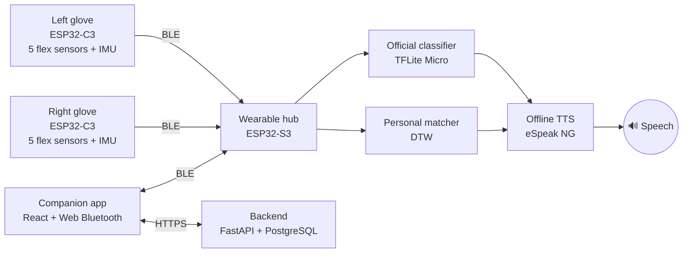

<div align="center">

# 🧤 Vaani Glove

### Sign language to speech, worn on your hands.

A wearable system that turns Indian Sign Language into spoken words, offline and in real time, for people who cannot speak.


<!-- Replace with a real photo or demo GIF of the gloves -->
<!--  -->

</div>

---

## About

People who cannot speak often depend on others understanding sign language, and most people around them don't. **Vaani Glove** gives signers their own voice. Two sensor gloves read hand shapes and motion, a small wearable hub recognises the sign, and the hub speaks it aloud. No camera, no internet connection and no phone are needed.

## Features

- **Speaks signs aloud.** On-device text-to-speech (eSpeak NG) runs entirely offline.
- **Official vocabulary.** About 60 Indian Sign Language signs are recognised by an on-device neural network (TensorFlow Lite Micro).
- **Personal vocabulary.** Users record their own signs in 2–3 repetitions with a typed meaning. Matching uses Dynamic Time Warping, so no retraining is needed.
- **Camera-free and private.** Flex sensors and IMUs capture hand data, and no images are ever taken.
- **Wireless.** The gloves stream sensor data to the hub over Bluetooth Low Energy.
- **Companion app.** Handles pairing, calibration, a live transcript, recording new signs, language settings and a "Test a Gesture" view.
- **Institution dashboard.** Shows anonymised usage insights for schools and rehabilitation centres.

## How it works



The two recognition pipelines are fully independent. The official classifier and the personal matcher never cross-reference each other.

## Tech stack

| Layer | Technology |
|---|---|
| Glove firmware | ESP32-C3 SuperMini, PlatformIO (Arduino framework) |
| Hub firmware | ESP32-S3, ESP-IDF, TensorFlow Lite Micro, eSpeak NG |
| Official model | TensorFlow → TFLite Micro |
| Personal matcher | DTW nearest-neighbour |
| Backend | FastAPI, PostgreSQL |
| Companion app | React, Vite, Tailwind CSS, Web Bluetooth |

## Repository structure

```
vaani-glove/
├── backend/            FastAPI + PostgreSQL API
├── app/                React companion app
├── firmware/
│   ├── hub/            ESP32-S3 hub (ESP-IDF)
│   ├── hub-ble-test/   Minimal hub for testing glove BLE links
│   └── glove/          ESP32-C3 glove firmware (PlatformIO)
├── ml/                 Model training and TFLite export
└── docs/               Images, diagrams, wiring
```

## Getting started

### Prerequisites

- Python 3.11+, PostgreSQL 15+
- Node.js 20+
- ESP-IDF 5.x (hub)
- VS Code with the PlatformIO extension (gloves)
- Chrome or Edge, since Web Bluetooth is not supported in Firefox or Safari

### 1. Backend

```bash
cd backend
python -m venv .venv
source .venv/bin/activate        # Windows: .venv\Scripts\activate
pip install -r requirements.txt
cp .env.example .env             # then fill in your database URL and secrets
uvicorn main:app --reload
```

API docs are then available at `http://localhost:8000/docs`.

### 2. Companion app

```bash
cd app
npm install
npm run dev
```

Open the printed local URL in Chrome or Edge.

### 3. Hub firmware (ESP32-S3)

```bash
cd firmware/hub
idf.py set-target esp32s3
idf.py build
idf.py -p <PORT> flash monitor
```

### 4. Glove firmware (ESP32-C3)

Open `firmware/glove` in VS Code with PlatformIO, then click **Upload**. You can also run:

```bash
cd firmware/glove
pio run -t upload
```

The gloves advertise over BLE as `Vaani-Left` and `Vaani-Right`.

## Project status

| Component | Status |
|---|---|
| Right glove: sensors, IMU, BLE | ✅ Working on hardware |
| Left glove | 🔧 Wiring in progress |
| Hub firmware | ✅ Built |
| Backend API | ✅ Working |
| App: auth and personal signs | ✅ Working |
| App: live recognition, settings, vocabulary browser | 🚧 In progress |
| App: Test a Gesture | 📋 Planned |

## Roadmap

- [ ] Complete the left glove and two-handed recognition
- [ ] Live recognition view in the companion app
- [ ] Over-the-air vocabulary updates
- [ ] Regional-language speech output
- [ ] Custom PCB and printed flex-sensor strips

## Team: Apex Trio

| Name | Role |
|---|---|
| **Rishi Jha** | Glove and hub firmware, hardware ([@rishi-jha-exe](https://github.com/rishi-jha-exe)) |
| **Prachi Sahu** | Backend and companion app |
| **Prakhar Sharma** | Team member |

B.Tech CSE, Amity University Madhya Pradesh.

## License

© 2026 Apex Trio. All rights reserved. This code is published for viewing and evaluation only. Reuse or redistribution requires written permission.
